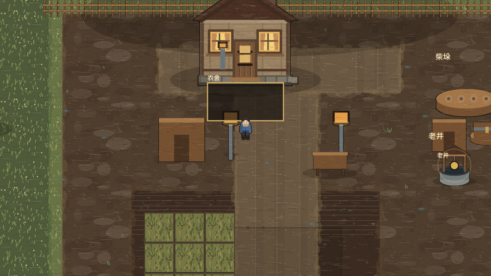
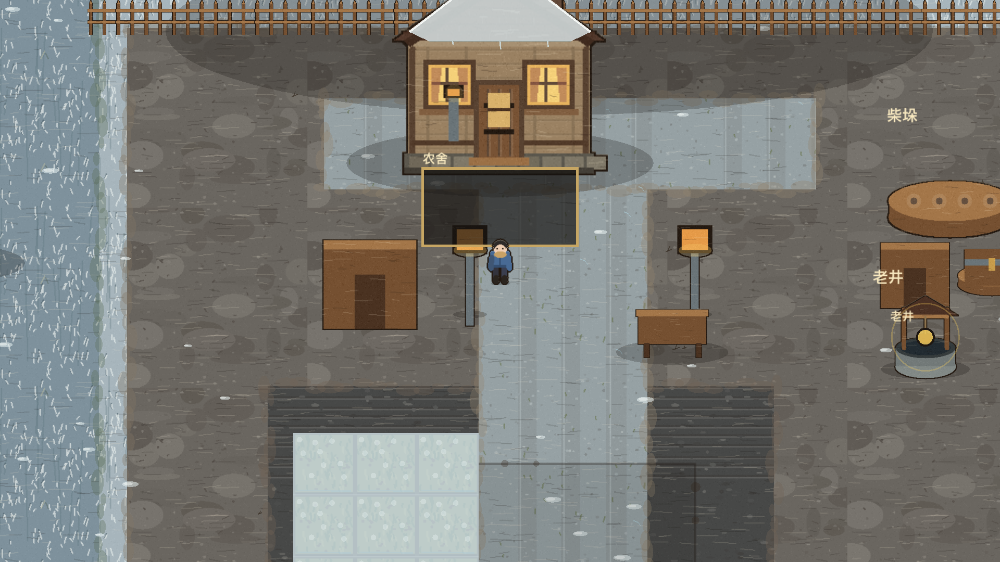

# 《宾州小镇》Binzhou Town

> **黑龙江黑土地治愈系种田游戏** · Godot 4.3 + GDScript
> 工程版本 `0.1.0-mvp` · 设计版本 v5.0 · 代号 `BZC-001`
> **CI 状态**:
> **设计状态**:v5 已于 2026-11-14 获制作人批准并完成全量实装验收。

---

## 一句话

AI 改变工作生活后,主角厌倦了大城市的喧嚣,回到黑龙江哈尔滨宾县的「宾州镇」,从一块 3×3 荒地开始,在松嫩平原的黑土地上重建生活 —— **春播秋收,一年一熟,冬季漫长休耕**。

当前版本已从单屏种田 Demo 扩展为 **11 个可进入场景、6 名核心 NPC、18 段好感故事、完整四季生活循环** 的小镇生活游戏。

---

## 当前内容

| 内容 | 实装量 | 说明 |
|---|---:|---|
| 可进入场景 | 11 | 5 个户外 + 6 个室内,空间门双向可达,相机跟随并钳制地图边界 |
| 核心 NPC | 6 | 张晓芳、韩守义、孙玉梅、赵长河、林小满、周德顺 |
| 好感事件 | 18 | 每人 3 段,严格按 20 → 50 → 80 递进,选择写回存档 |
| 日常对白 | 41 个条目 | 每名 NPC 每季至少 4 条季节化内容,含天气/时段/事件后差分 |
| 地图 | 11 张 | L01-L11,尺寸 1280×896 至 3840×1920 |
| 作物 | 9 种 | 一年一熟、秋霜、早收复种、秋翻增产 |
| 农场扩建 | 9 → 24 块 | 3×3 起步,木工房扩建至 6×4,旧档与坐标完整保留 |
| 采集点 | 19 个 | 河岸/桦树林四季刷新 |
| 鱼类 | 8 种 | 季节鱼池、等待/咬钩/收线 |
| 菜谱 | 12 道 | 食材 → 做菜 → 回体力/送礼闭环 |
| 任务 | 18 条 | 公告板与人物委托,接取/进度/交付/奖励/存档 |
| 节日 | 4 个 | 春耕、河灯、秋收、上元;场景内互动参与 |
| 明信片 | 3 位联系人 / 6 张回信 | 次日投递、跨年、收藏、云目录镜像 |

---

## 世界观锚点

| 项 | 内容 |
|---|---|
| 真实地理 | **黑龙江省哈尔滨市宾县**(古称「宾州厅」,1880 建府,1913 改宾县),松花江南岸,松嫩平原黑土地核心区 |
| 虚构地名 | 包内小镇「**宾州镇**」,与真实「宾州/宾县」同音,叙事完全自由 |
| 气候 | 寒温带大陆性气候 · **一年一熟** · 无霜期约 130-150 天 · 夏季日照长 · 冬季漫长严寒 |
| 农业结构 | **春播(4-5月)→ 夏长(6-8月)→ 秋收(9-10月)→ 冬歇(11-2月)** |

| 季 | 物候 | 农事 | 核心玩法 |
|---|---|---|---|
| **春** | 惊蛰开河,地化冻 | 翻土、播种 | 全年唯一播种窗口 |
| **夏** | 白昼漫长,日照足 | 浇水、除草、追肥 | 长线管理 + 早收腾茬复种 |
| **秋** | 霜降收秋,场院打粮 | 收割、晾晒、入窖 | 丰收结算 + 秋霜压力 |
| **冬** | 漫长休耕,火炕守岁 | 禁播种;可秋翻地 | 加工/腌制/年货/走亲戚 |

---

## 四支柱(v5)

| 支柱 | 占比 | 玩家行为 | 场景 |
|---|---:|---|---|
| **黑土地生活** | 35% | 翻土、播种、浇水、收获、秋翻、扩建、采集、钓鱼、冬储 | 农场、农舍、河岸、桦树林 |
| **小镇社会** | 25% | 买东西、吃饭、看病、修工具、寄信、接委托、参加集市 | 镇中心、杂货店、邮局、饭馆、卫生所、木工房 |
| **人物故事** | 25% | 观察日程、送礼、聊天、触发好感事件、做人物委托 | 6 名 NPC、18 个事件、关系网 |
| **季节活动** | 15% | 春耕、夏汛、秋收、冬歇;节日与年货 | 四季环境、4 个节日、古戏台演出 |

---

## 场景地图

| ID | 场景 | 核心用途 |
|---|---|---|
| L01 | 自家农场 | 种田、秋翻、采集与前往镇中心 |
| L02 | 农舍室内 | 火炕睡觉、灶台做饭、储物、看预报 |
| L03 | 宾州镇中心 | 社交、集市、公告板、节日、通往商铺 |
| L04 | 杂货店 | 买种子/工具/礼物,卖粮 |
| L05 | 老邮局 | 寄信、在途、收藏册 |
| L06 | 玉梅饭馆 | 吃饭回体力、打听消息、NPC 午饭聚集 |
| L07 | 镇卫生所 | 恢复疲劳、林小满日程 |
| L08 | 赵家木工房 | 农场扩建、工具与木材 |
| L09 | 河岸 | 钓鱼、采集、夏汛与河灯节 |
| L10 | 桦树林 | 采集、柴火、蘑菇、迷路事件 |
| L11 | 古戏台 | 二人转、节日、周德顺故事 |

---

## 玩法闭环

```text
起床(农舍) → 看天气/预报 → 照料农场 → 去镇上办事/送礼/接委托
→ 去河岸或树林采集/钓鱼 → 回饭馆吃饭或回家做饭
→ 黄昏触发人物事件/节日 → 回农舍火炕睡觉 → 日结算
```

### 时间与天气

- 一天从 **06:00** 开始,最晚到 **26:00(次日 02:00)**;1 游戏分钟 = 0.9 现实秒。
- 对话框、背包、商店、事件选择打开时暂停时钟;走路、干活、钓鱼时继续。
- 02:00 未睡会强制结算,次日体力上限暂时下降;不死亡、不删档。
- 睡觉必须回到 **L02 农舍火炕**并靠近床边,任意地点按 `T` 不再跳天。
- 天气由季节权重 + 存档种子 + 绝对日决定;次日预报可见,读档不会改变当天天气。

### 四季环境

- 春:融雪、泥泞、返青;夏:浓绿、强光、长草;秋:土金、赭红、霜白;冬:雪青、暖窗、烟囱白烟。
- 地面材质、树草、建筑屋顶、地块罩色、天气粒子、NPC 冬装与 HUD 节气提示同步变化。
- 室内使用克制的暖尘微光,不会出现穿屋下雨/下雪。
- 冬季地块会真实盖雪,不会继续显示绿色苗床。

### 人物与好感

- 6 名 NPC 各自拥有欲望、秘密、关系网、日程、喜恶、生日与独立弧线。
- 好感门槛为 **20 / 50 / 80**,不能跳级;触发还受季节、地点、时段与前置 flag 约束。
- 18 段事件均走通 `can_trigger → start_event → 选择 → finish_event`,状态与次日余波入档。
- 日程按时间、季节、雨天/暴雪与夜间变化;饭馆午饭时段会自然聚集 NPC。
- 礼物喜恶、生日反馈、事件后对白与关系网交叉内容均已接线。

### 种田四机制

| 机制 | 说明 |
|---|---|
| **一年一熟 / 冬季禁播** | 播种窗口仅 4-5 月,错过即当年绝收;冬季不能播种 |
| **早收腾茬复种** | 马铃薯/春小麦/亚麻早收后,7 月可抢种一茬秋菜 |
| **秋霜冻死** | 晚收作物拖过霜期会冻死在地里 |
| **秋翻地 +15%** | 秋收后或冬季深翻积肥,次年同地块增产 |

---

## 美术与 AI 说明

- 当前交付资产来自 **确定性程序化手绘管线**:`tools/pixelart.py` + `tools/gen_art.py`,可重复生成,零第三方依赖。
- 角色帧为 **48×72**,约为一块地(88px)的 2/3;NPC 有四季通用形象与冬装差分。
- 农舍与木屋包含木板墙、石基、层叠木瓦、窗帘、门灯、烟囱与淡烟;冬季增加屋顶积雪与冰挂。
- 本轮环境没有官方 `image_gen` 工具,也没有 MiniMax/OpenAI key,因此 **未执行新的 AI 生图**。设计允许 AI 作为概念图/材质母版,但最终 sprite、瓦片、碰撞与动画仍由确定性管线制作;后续提供 key 可按设计文档补 4 季场景板与人物立绘母版。
- 正式四季验收图见 `docs/screenshots/seasons/`。





---

## 操作键位

| 键 / 手柄 | 作用 |
|---|---|
| `WASD` / 左摇杆、D-pad | 移动(4 方向,斜向取主轴) |
| `E` / A | 交互、对话、采集、开门、调查 |
| `J` / X | 翻土 |
| `K` / Y | 浇水 |
| `L` / LB | 播种 |
| `I` / RB | 收获 |
| `R` / 右摇杆按下 | 秋翻地(深翻积肥) |
| `TAB` / BACK | 背包(庄稼栏 / 物件栏) |
| `T` / 左摇杆按下 | 在农舍火炕旁睡觉 |
| `F` / GUIDE | 调试用快速换图(正式移动请走空间门) |
| `P` / B | 调试用快速前往邮局 |
| `ESC` / START | 暂停菜单(存档/读档/回主菜单/退出) |

> 多数地点通过走到门口自动切换;`F/P` 只保留给旧测试与开发调试。

---

## 项目结构

```text
binzhou-town/
├── project.godot                 # Godot 4.3,1920×1080 基准分辨率
├── scenes/
│   ├── main_menu.tscn            # 主菜单 + 性别选择
│   ├── game.tscn                 # 游戏外壳:HUD、模态层、世界容器
│   ├── location.tscn             # L01-L11 通用地点场景
│   └── locations/L01-L11.tscn    # 11 张地图的薄包装
├── data/
│   ├── maps.json                 # 尺寸、出生点、门、互动点、农田区
│   ├── npcs.json                 # 6 名 NPC、日程、喜恶、生日、立绘路径
│   ├── dialogues.json            # 41 个日常对话条目
│   ├── events.json               # 18 段好感事件
│   ├── quests.json               # 18 条公告板/人物委托
│   ├── festivals.json            # 4 个节日
│   ├── forage.json / fish.json   # 19 个采集点 / 8 种鱼
│   ├── recipes.json              # 12 道菜谱
│   └── crops.json / items.json   # 9 种作物 / 73 件道具
├── scripts/
│   ├── core/                     # 时钟、日历、天气、存档、模态栈、GameManager
│   ├── world/                    # 地图数据库、渲染、地点外壳、空间门
│   ├── npc/                      # 注册表、日程、关系、事件
│   ├── farming/                  # 地块、作物、工具、扩建、农时
│   ├── activities/               # 采集、钓鱼、烹饪、节日、任务
│   ├── dialogue/ shop/ postcard/ # 对话、商店、明信片
│   ├── ui/                       # HUD、对话框、各面板、天气层
│   └── tests/                    # 16 组 headless 自测
├── assets/                       # 角色/NPC/地块/作物/道具/地形/语音
├── docs/screenshots/seasons/     # 四季正式验收截图
└── tools/                        # 美术生成、数据校验、截图、语音、AI 母版管线
```

---

## 本地开发与验收

```bash
# 导入项目
godot --headless --import --quit

# 重新生成确定性美术资源
python3 tools/gen_art.py assets

# 静态数据校验
python3 tools/validate_data.py data/

# 全量 16 组测试
for t in test_acceptance test_art test_activities test_npc_social test_world \
  test_clock_weather test_save_v2 test_core test_scenes test_integration \
  test_dialogue test_shop test_inventory test_dialogue_wiring test_input_map test_postcard; do
  godot --headless --script "res://scripts/tests/$t.gd"
done

# 四季验收截图
python3 tools/capture_scenes.py \
  --out docs/screenshots/seasons \
  --scenes game L01 L03 L09 L10 L11 \
  --seasons spring summer autumn winter \
  --frames 8 --time 12:00 --weather sunny

# 1080p 性能检查
godot --path . --resolution 1920x1080 --disable-vsync --print-fps \
  --quit-after 3000 scenes/game.tscn
```

### 当前实测结果

| 测试组 | 通过数 |
|---|---:|
| `test_acceptance` | 44 |
| `test_art` | 128 |
| `test_activities` | 100 |
| `test_npc_social` | 239 |
| `test_world` | 154 |
| `test_clock_weather` | 63 |
| `test_save_v2` | 37 |
| `test_core` | 261 |
| `test_scenes` | 18 |
| `test_integration` | 90 |
| `test_dialogue` | 57 |
| `test_shop` | 44 |
| `test_inventory` | 22 |
| `test_dialogue_wiring` | 39 |
| `test_input_map` | 57 |
| `test_postcard` | 61 |
| **合计** | **1414 通过 / 0 失败** |

另有 `python3 tools/validate_controls.py` 校验 15 个游戏动作与 Steam Input 模板一致且无按钮冲突,CI 必跑。

- 数据校验:**11 地图 / 6 NPC / 18 事件 / 41 对话条目 / 19 采集点 / 8 鱼 / 12 菜谱 / 18 任务 / 4 节日**。
- 场景冒烟:主菜单、游戏外壳、11 张地点场景全部无脚本错误。
- 性能:1080p、关闭垂直同步,实测 **771 FPS(1.29 mspf)**,远高于 60 FPS 目标。

---

## 文档链

| 文档 | 说明 |
|---|---|
| `docs/superpowers/specs/2026-11-13-星露谷级世界与人物-design.md` | v5 主设计(已批准) |
| `docs/BZC-人物圣经-v5.md` | 6 名 NPC 的人物内核、关系网、日程与 18 段事件 |
| `docs/BZC-代码审查-2026-11-13.md` | 代码审查与 2026-11-14 复审结论 |
| `docs/BZC-进度追踪-v4.md` | 旧周计划(历史) + v5 全量实装进度与验收数字 |
| `docs/superpowers/plans/2026-11-13-星露谷级世界与人物-实施计划.md` | Task 1-10 实施计划 |
| `docs/宾州小镇_完整游戏企划_v4.md` | 世界观与长线企划 |
| `docs/黑龙江资料卡.md` | 黑龙江农业地理与民俗核实版资料 |
| `docs/BZC-MVP-TechSpec-v4.md` | MVP 技术规格 |
| `docs/BZC-ArtProposals-v4.md` | D8 美术方案 |
| `docs/ai-imagegen.md` | AI 母版管线、prompt 模板与限制 |

---

## License

MIT
